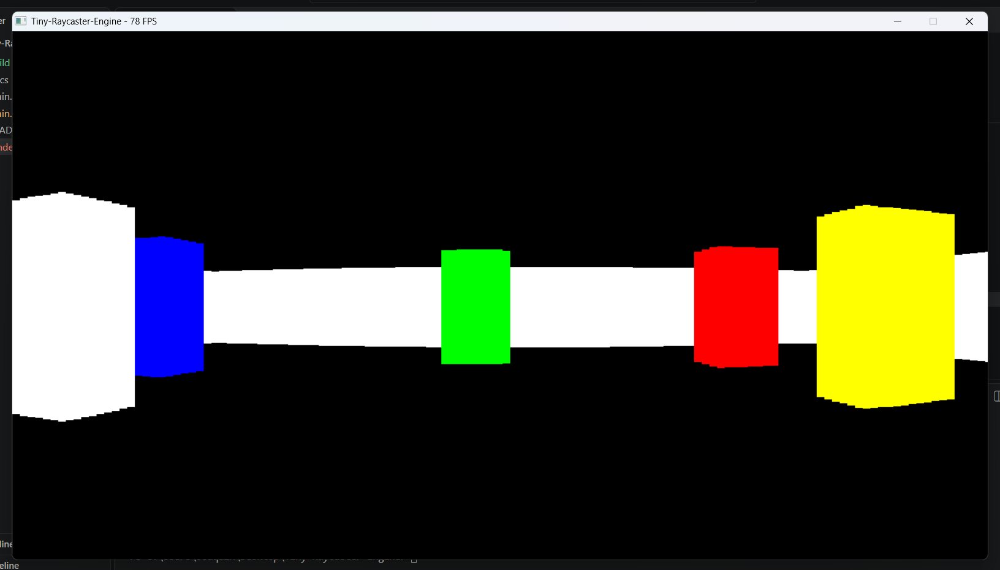
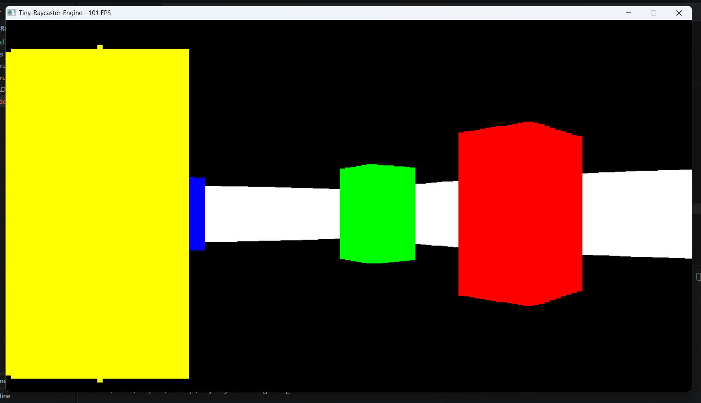
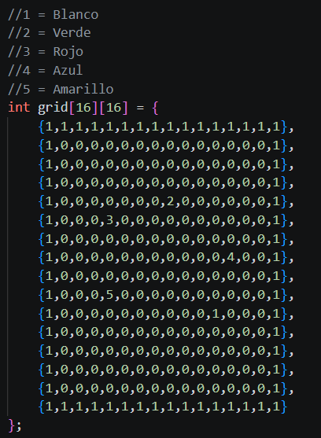
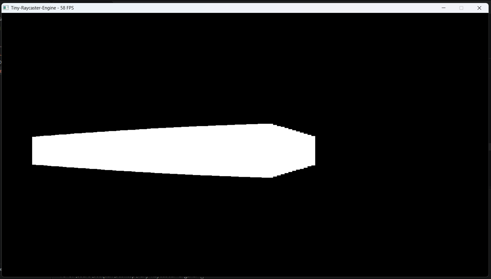

# Tiny-Raycaster-Engine

A lightweight, dependency-free pseudo-3D raycasting engine written from scratch in C++ for Windows. It renders a 3D perspective world onto a 2D software framebuffer using pure Win32 API and GDI (`StretchDIBits`) without external graphics libraries like OpenGL, DirectX, or SDL.

Inspired by retro classics like *Wolfenstein 3D*, this project implements ray-box intersection algorithms, delta-time player movement, color-coded map grids, and real-time software rendering.

---

## 📸 Screenshots

| Perspective Renderer | Distance Scaling |
|:---:|:---:|
|  |  |
| *Multi-colored columns and walls* | *Dynamic vertical slice scaling based on distance* |

| Map Grid System | Out-of-Bounds & Fog Limit |
|:---:|:---:|
|  |  |
| *16x16 integer-mapped layout* | *Ray limit handling at max render distance* |

---

## ✨ Features

- **Pure Software Rendering**: Directly writes 32-bit RGB color pixels to an in-memory framebuffer and blits it to the window via Windows GDI (`StretchDIBits`).
- **Zero External Dependencies**: Built strictly using the C++ standard library and native Windows headers (`<windows.h>`, `<chrono>`, `<cmath>`, `<algorithm>`).
- **DDA-Style Raycasting**:
  - 90° Field of View (FOV).
  - 128 discrete ray sections across a 1280x720 viewport.
  - Euclidean ray step casting with precalculated AABB (Axis-Aligned Bounding Box) block boundaries for fast collision checks.
- **Dynamic Wall Coloring**: Grid tiles support distinct wall color presets:
  - `1`: White (`0x00FFFFFF`)
  - `2`: Green (`0x0000FF00`)
  - `3`: Red (`0x00FF0000`)
  - `4`: Blue (`0x000000FF`)
  - `5`: Yellow (`0x00FFFF00`)
- **Smooth Player Movement**:
  - Full 4-directional movement (forward, backward, strafe left/right) and camera rotation.
  - Delta-time calculation (`std::chrono::high_resolution_clock`) for smooth, framerate-independent speed.
  - Sprint toggle for rapid navigation.
- **Diagnostics & Debugging**:
  - Real-time FPS counter displayed directly in the window title bar.
  - Toggleable debug console via `AllocConsole()`.

---

## 🎮 Controls

| Key / Input | Action |
| :--- | :--- |
| <kbd>W</kbd> | Move Forward |
| <kbd>S</kbd> | Move Backward |
| <kbd>A</kbd> | Strafe Left |
| <kbd>D</kbd> | Strafe Right |
| <kbd>←</kbd> (Left Arrow) | Rotate Camera Left |
| <kbd>→</kbd> (Right Arrow) | Rotate Camera Right |
| <kbd>Shift</kbd> *(Hold)* | Sprint (Boost movement speed from 200 to 400) |
| <kbd>E</kbd> | Toggle Debug Console (`AllocConsole`) |

---

## 🛠️ How It Works

1. **Window & Framebuffer Setup (`main.cpp`)**:
   - Creates a standard Win32 window (`1280x720`) with message dispatch handling.
   - Allocates a contiguous heap array of `uint32_t` pixels representing the display surface.

2. **AABB Precalculation (`renderer.hpp`)**:
   - `precalculate_areas()` scans the 16x16 grid and computes bounding coordinate thresholds (`[X_min, X_max]`, `[Y_min, Y_max]`) for each solid cell, accelerating per-ray collision detection.

3. **Ray Stepping & Intersection (`calculate_rays()`)**:
   - Casts 128 rays spread uniformly across the 90° FOV.
   - Steps each ray outward by increments along its trigonometric vector `(cos(θ), sin(θ))` until it intersects a block's bounding box or hits the maximum render distance (400 steps).

4. **Wall Height Projection (`draw_sections()`)**:
   - Computes column slice height using inverse distance projection:
     $$\text{wall\_height} = \frac{\text{win\_height} \times 40}{\text{distance}}$$
   - Fills the corresponding rectangle vertical section in the framebuffer with the hit cell's color.

5. **Blit**:
   - `StretchDIBits` draws the framebuffer directly to the device context (`HDC`) every frame.

---

## 🗺️ Customizing the Map

You can modify the map layout directly inside `renderer.hpp` by altering the `grid` matrix. `0` represents empty walkable space, and any non-zero value represents a colored solid block:

```cpp
// 1 = White, 2 = Green, 3 = Red, 4 = Blue, 5 = Yellow
int grid[16][16] = {
    {1,1,1,1,1,1,1,1,1,1,1,1,1,1,1,1},
    {1,0,0,0,0,0,0,0,0,0,0,0,0,0,0,1},
    {1,0,0,0,0,0,0,0,2,0,0,0,0,0,0,1},
    {1,0,0,0,3,0,0,0,0,0,0,0,0,0,0,1},
    {1,0,0,0,0,0,0,0,0,0,0,0,4,0,0,1},
    {1,0,0,0,5,0,0,0,0,0,0,0,0,0,0,1},
    // ...
    {1,1,1,1,1,1,1,1,1,1,1,1,1,1,1,1}
};
```

---

## 🚀 Building & Running

### Prerequisites
- Windows 10 / 11
- C++17 compatible compiler (e.g., MinGW-w64 `g++` or MSVC `cl`)

### Build with GCC / MinGW

Open PowerShell or Command Prompt in the repository root directory and run:

```powershell
# Create build directory if it doesn't exist
if (!(Test-Path "build")) { New-Item -ItemType Directory -Name "build" }

# Compile
g++ -O2 -std=c++17 main.cpp -o build/main.exe -lgdi32

# Run
.\build\main.exe
```

---

## 📁 Project Structure

```text
Tiny-Raycaster-Engine/
├── build/
│   └── main.exe              # Compiled binary executable
├── docs/
│   ├── base_pic.png          # Screenshot of rendered scene
│   ├── distance_calc_pic.png # Screenshot of perspective distance scaling
│   ├── grid_code.png         # Image of the 16x16 grid definition
│   └── out_of_bounds.png     # Screenshot showing max render cutoff
├── main.cpp                  # Win32 window creation, event loop, FPS counter & input
├── renderer.hpp              # Raycasting mathematics, AABB collisions, framebuffer rendering
└── README.md                 # Project documentation
```

---

## 🔮 Future Improvements

- [ ] Fish-eye distortion correction via cosine perpendicular distance (`cos(ray_angle - player_angle)`).
- [ ] DDA (Digital Differential Analyzer) grid traversal for pixel-perfect wall hit detection.
- [ ] Wall textures and floor / ceiling drawing.
- [ ] Collision detection against walls for player movement.
- [ ] Sprite / entity rendering (enemies, pickups, items).
